Kallabot is an AI agent platform for small businesses such as clinics, property brokers and stores. One agent answers and makes phone calls and replies on WhatsApp, Messenger, Instagram and your website's chat, in around 50 languages, with strong Gulf Arabic, Urdu and English and a UAE focus. This page lists every release, newest first.

<Frame caption="One agent on every channel, in the languages your customers speak.">
  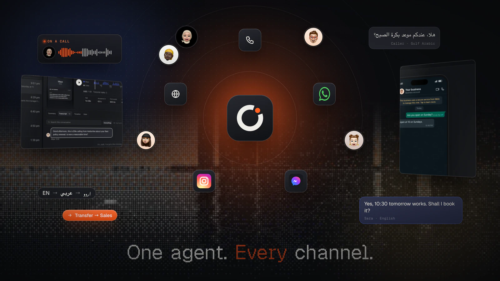
</Frame>

## At a glance

<CardGroup cols={3}>
  <Card title="Phone agents" icon="phone" href="/guides/agents">
    Answer and make calls in natural Gulf Arabic, Urdu, English and around 50 languages.
  </Card>
  <Card title="Chat channels" icon="message-circle" href="/guides/whatsapp">
    The same agent on WhatsApp, Messenger, Instagram and website chat.
  </Card>
  <Card title="Live call console" icon="headphones" href="/guides/live-console">
    Listen in, whisper, take over or transfer any live call.
  </Card>
  <Card title="Knowledge" icon="book-open" href="/guides/knowledge">
    Teach agents from websites, PDFs, Word files and Google Sheets.
  </Card>
  <Card title="Numbers and carriers" icon="hash" href="/guides/phone-numbers">
    Buy numbers, port or forward them, or bring your own carrier over SIP.
  </Card>
  <Card title="Developer platform" icon="terminal" href="/developers/introduction">
    A public REST API, TypeScript and Python SDKs and 35 signed webhook events.
  </Card>
</CardGroup>

<Update label="2026-11-07" description="Personal API keys, SDKs, browser calls and billing" tags={["API", "Developers", "Security", "Billing"]} rss={{ title: "Personal API keys, SDKs, browser calls and billing", description: "Personal API keys, official TypeScript and Python SDKs, direct browser web calls, API transfers, IP allowlists, dated API versions, the knowledge API and billing." }}>
  ## Personal API keys

  Kallabot now has personal API keys that act as the teammate who created them, alongside workspace keys for automations.

  <Frame caption="Personal keys carry a person's name and role; workspace keys run automations.">
    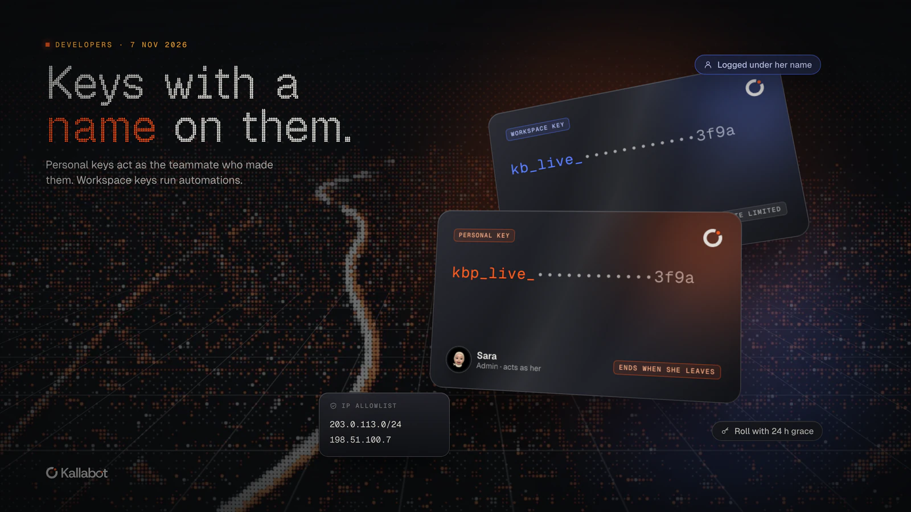
  </Frame>

  - **Personal API keys** (`kbp_live_…`) act as the teammate who made them, are logged under their name, are capped by their current role, and stop when they leave. Workspace keys (`kb_live_…`) stay for automations. See [Authentication](/developers/authentication#two-kinds-of-key).
  - Whispering, listening in, taking over, call notes, and number and minute requests need a personal key (`403 personal_key_required` otherwise).
  - **Transfers through the API.** Workspace keys can transfer a live call to the agent's configured destinations; transferring to a typed number needs a personal key.
  - **IP allowlist** in **Settings → API keys → Allowed IP addresses**, up to 20 entries.
  - **Roll** now keeps the old key working for 24 hours.

  ## TypeScript and Python SDKs

  Official TypeScript and Python SDKs wrap the whole Kallabot API, generated from the same OpenAPI spec as the API reference.

  <Frame caption="Place a call in four lines with the TypeScript SDK.">
    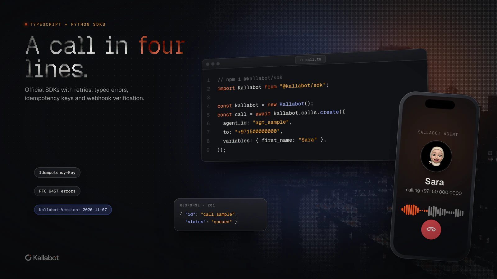
  </Frame>

  - Automatic idempotency keys, retries, typed errors, auto-pagination and webhook verification.
  - A browser call client for web calls.
  - TypeScript runs on Node 18+, Deno, Bun, Cloudflare Workers, Vercel Edge and browsers; Python 3.9+ has sync and async clients.
  - Publishing to npm and PyPI is coming soon. See [SDKs](/developers/sdks).

  ## Browser web calls with no server relay

  Your website can now start a voice call with your agent directly from the visitor's browser. Your server creates a session with `allowed_origin`; the browser connects with the single-use grant through `/client/offer`. See [Web calls](/developers/web-calls).

  ## API conventions

  - **One pagination style everywhere:** `limit` and `cursor` in, `data`, `next_cursor` and `has_more` out. See [Pagination](/developers/pagination).
  - **`Idempotency-Key` is required** on every create and action `POST`. See [Idempotency](/developers/idempotency).
  - **Dated API versions** with the optional `Kallabot-Version: 2026-11-07` header, echoed on every response. See [Versioning](/developers/versioning).
  - **Rate limits** of 600 requests a minute per key, 1,200 per signed-in person and 3,000 per workspace, with `RateLimit-*` headers. See [Rate limits](/developers/rate-limits).
  - New error codes: `personal_key_required`, `key_owner_inactive`, `invalid_webcall_origin`, `unsupported_api_version`, `sdk_version_unsupported`.

  ## Also in this release

  - **Knowledge API:** add, edit and delete knowledge sources through the API. See [Knowledge](/developers/knowledge).
  - **Webhook events reference:** all 35 events now have their own pages in the API reference.
  - **Billing:** plans (Agent, Brokerage with a 14-day trial, Enterprise), minute packs, auto top-up and Stripe's billing portal, in the app and the API. See [Plans and billing](/guides/billing).
  - **Security hardening:** API scopes now follow each role exactly, so no key can do more than its owner's role allows, and production refuses to start with unsafe security settings, following a November 2026 security audit.
</Update>

<Update label="2026-11-05" description="Live call console and voicemail detection" tags={["Voice", "Calls"]} rss={{ title: "Live call console and voicemail detection", description: "Listen in, take over, hand back and transfer live calls, take a call on your own phone, and let outbound calls detect voicemail." }}>
  ## Live call console: listen in, take over, whisper, transfer

  The live console lets a teammate join any call the agent is on, without the caller noticing until they speak.

  <Frame caption="The live console: live transcript, the people on the line, tools and private notes.">
    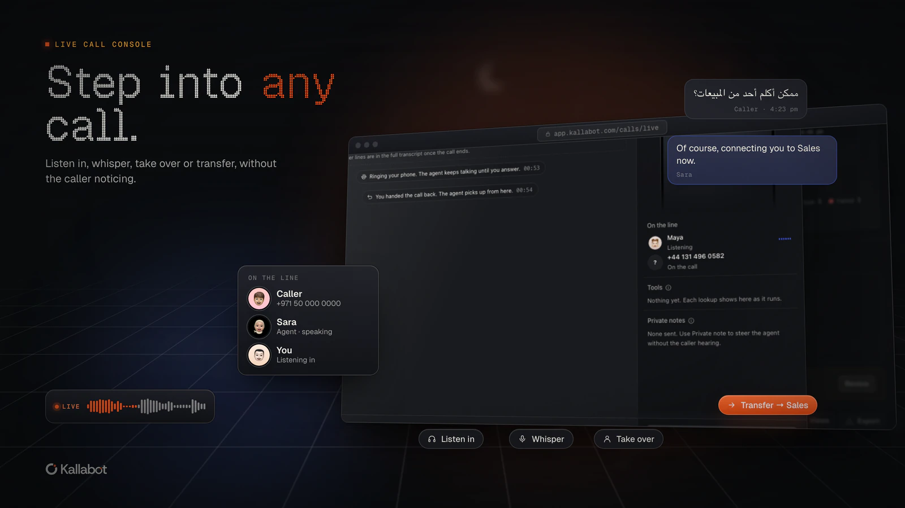
  </Frame>

  - **Listen in** through your computer; the caller and the agent don't hear you.
  - **Whisper** a private note the agent reads before its next answer and never says aloud.
  - **Take over** with your microphone, then **hand back** to the agent, which picks up where you left off.
  - **Transfer** the caller to a person, or have Kallabot **ring your own phone** and join from there.
  - Every listen-in, take-over and transfer is noted on the call's timeline with the teammate's name.

  See [Live console](/guides/live-console).

  ## Voicemail detection

  Outbound calls now tell a person from a voicemail and act on it.

  <Frame caption="A person gets a conversation; a voicemail gets your message, once.">
    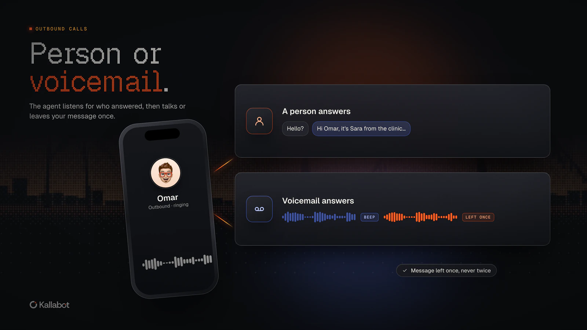
  </Frame>

  - The agent waits a moment to hear who answered.
  - On voicemail it waits for the beep, leaves your message once and hangs up.
  - Each detection fires the `call.voicemail.detected` webhook.

  See [Voicemail](/guides/voicemail).

  ## Also in this release

  - **Whole-call recordings** keep recording through a transfer, and the transcript labels the turns after it.
  - **Per-agent LLM fallback:** if the agent's model stalls, a second model answers instead.
  - **Webhook contract** for developers: every event's payload is documented. See [Events](/developers/events).
</Update>

<Update label="2026-11-04" description="Web chat with voice, inbox attachments and analytics reports" tags={["Channels", "Analytics", "Voice"]} rss={{ title: "Web chat with voice, inbox attachments and analytics reports", description: "A website chat widget with voice, attachments in the inbox, analytics reports and better Urdu speech." }}>
  ## Website chat widget with voice

  Kallabot's web chat puts your agent on your website as a chat bubble that can also take voice calls.

  <Frame caption="The web chat studio: design the widget, pick the agent, copy one line.">
    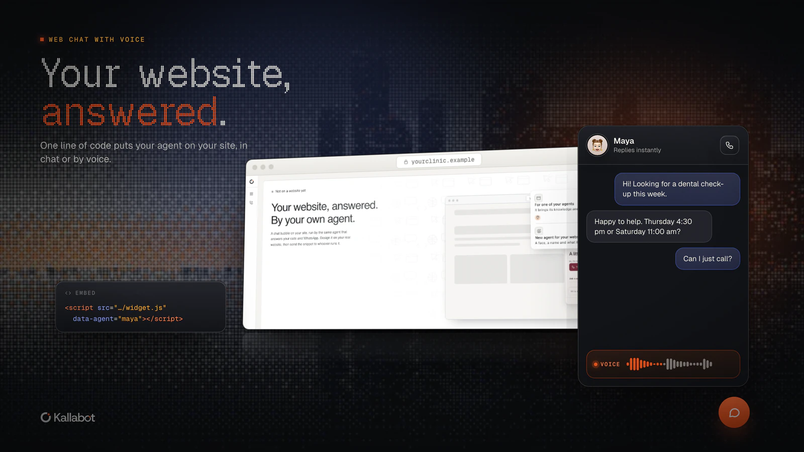
  </Frame>

  - Run by the same agent that answers your calls and WhatsApp, with its knowledge and instructions.
  - Visitors can type or talk; voice runs over WebRTC in the browser.
  - Install with one line on WordPress, Wix, Shopify, Webflow or any site.
  - Files and photos in web chat and the inbox are now real attachments.

  See [Web chat](/guides/web-chat).

  ## Analytics reports

  Analytics now opens with a plain sentence about your period across every channel, with reports you can share.

  <Frame caption="Analytics: conversations, how many the agents handled alone, and what needs a look.">
    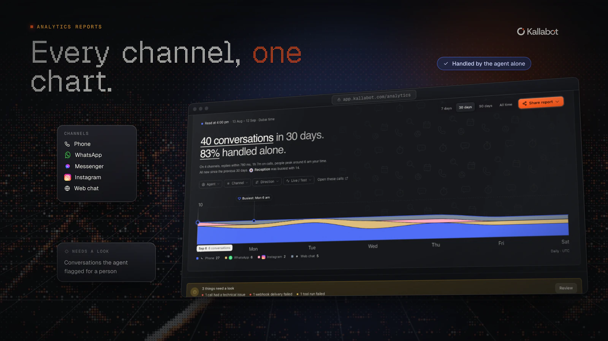
  </Frame>

  - Conversations across phone, WhatsApp, Messenger, Instagram and web chat on one chart.
  - Handled by agents, first reply time, talk time, hand-offs and bookings.
  - Weekly email reports and share links. See [Analytics](/guides/analytics).

  ## Also in this release

  - **Urdu sounds like Urdu:** Urdu replies are no longer pronounced as Arabic, and the agent speaks the everyday Urdu register.
  - **Call control on our own edge:** live calls are now controlled directly on Kallabot's Asterisk edge.
  - **ElevenLabs v3 and v4 voices** run alongside Cartesia.
  - Outbound calls ring for 60 seconds before giving up (was 30).
  - A greeting with no name ("Salaam!") gets a proper introduction first.
</Update>

<Update label="2026-11-03" description="Numbers, verification and caller trust" tags={["Numbers", "Voice"]} rss={{ title: "Numbers, verification and caller trust", description: "Real number verification, caller trust and spam labelling, number routing and a faster default voice model." }}>
  ## Caller ID trust and spam labelling

  Kallabot now helps your outbound calls get answered instead of labelled as spam.

  <Frame caption="Signed calls, caller name and spam check registration, with health for every number.">
    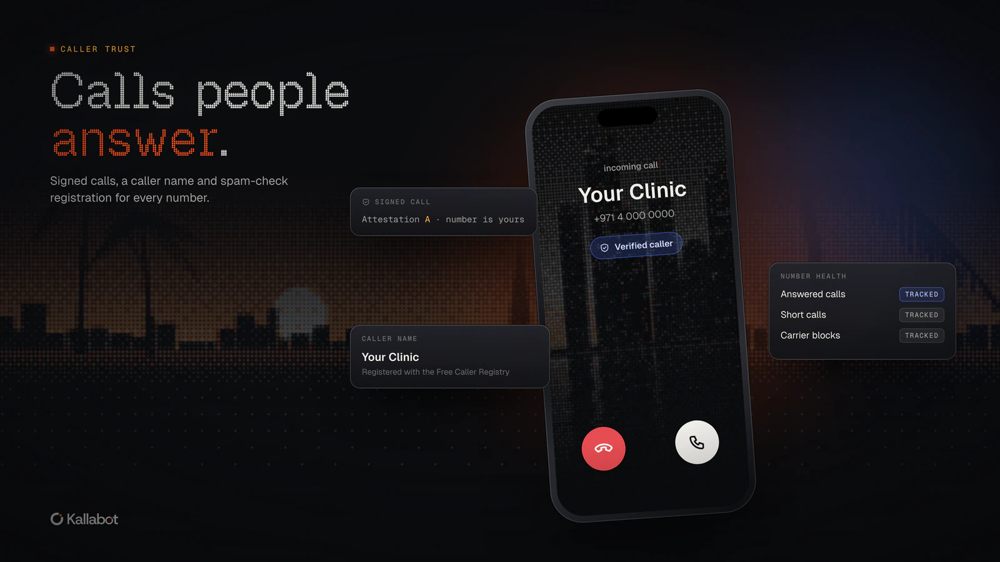
  </Frame>

  - **Signed calls** carry a digital signature that proves the number is yours.
  - **Caller name** chooses what people see when you call.
  - **Spam check registration** with the Free Caller Registry that the big US carriers use.
  - **Number health** tracks answered calls, short calls and carrier blocks for every number.

  See [Caller trust](/guides/caller-trust).

  ## Phone numbers and verification

  Buying, verifying and routing numbers now runs end to end.

  <Frame caption="Your numbers, who answers each one, and what's waiting for approval.">
    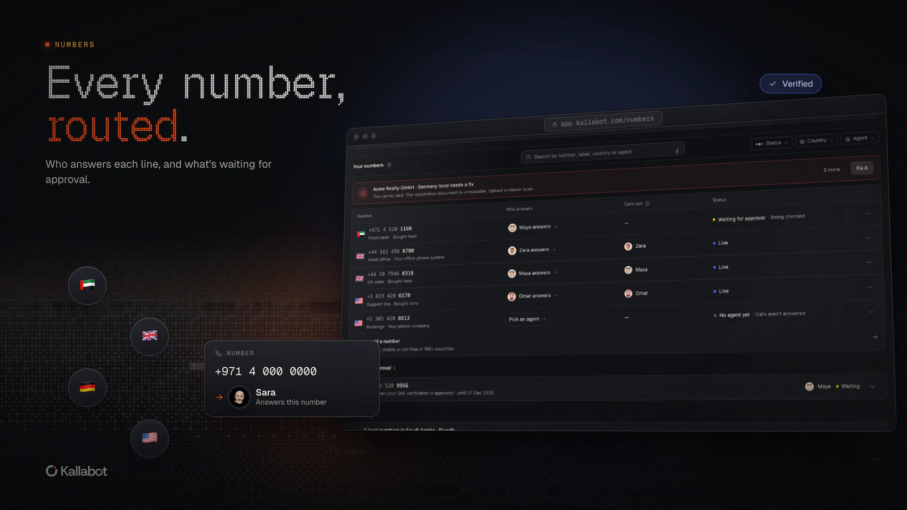
  </Frame>

  - Number verification for countries that require it, with status on every number. See [Verification](/guides/verification).
  - Choose which agent answers each number, and the number each agent calls from.
  - Requests for numbers in countries you can't buy instantly. See [Phone numbers](/guides/phone-numbers).

  ## Also in this release

  - **Faster default model:** DeepSeek V4.1 Flash on Baseten is the platform default, with automatic failover to a second provider.
  - **Soniox** speech recognition is the default for every new agent.
  - **Knowledge on every turn:** calls search the agent's knowledge as the conversation moves, not only at the start.
</Update>

<Update label="November 2026" description="The new Kallabot platform" tags={["Product", "API", "Developers"]} rss={{ title: "The new Kallabot platform", description: "A rebuilt platform: agents on every channel, a new public API, signed webhooks and these docs." }}>
  ## The new Kallabot

  Kallabot has been rebuilt from the ground up. One agent now works across phone, WhatsApp, Messenger, Instagram and your website, and everything it does is visible and controllable.

  <Frame caption="Your agents on shift, with what needs you on each card.">
    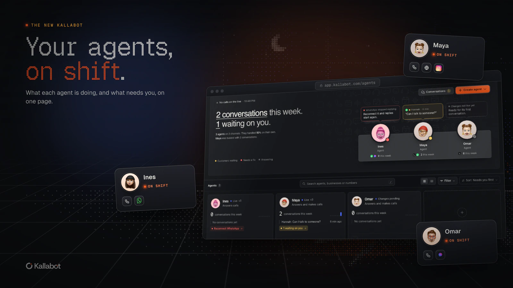
  </Frame>

  **Agents**

  - A six-step agent builder (Identity, Voice, Instructions, Knowledge, Tools, Channels) with a live preview, templates and duplication.
  - Around 50 languages with regional dialects, including Emirati, Saudi, Egyptian and other Arabic dialects, and callers who switch language mid-sentence.
  - Natural turn-taking: the agent waits until callers have finished, can be interrupted, and backchannels while they talk.
  - Voice cloning in the voice lab.
  - Drafts, publishing and version history with one-click restore.

  <Frame caption="The agent builder: a face, where it operates, and separate words for calls and for chat.">
    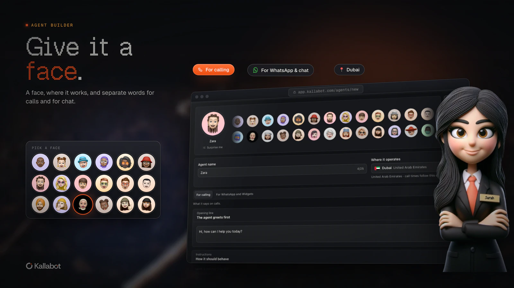
  </Frame>

  **Channels**

  - Phone numbers in many countries, number forwarding, number porting, and bring-your-own carrier or office phone system over SIP.
  - Number verification for countries that require it, and caller trust (signed calls, caller name, spam check registration, number health).
  - WhatsApp through Meta Embedded Signup, including numbers that stay on the WhatsApp Business app, with message templates and a full studio.
  - Messenger and Instagram, with comment-to-DM and story mention replies.
  - A web chat widget with a visual studio, voice, and a one-line install.

  **Working alongside your agents**

  - One inbox for WhatsApp, Instagram, Messenger and web chat, with take-over, hand-back, notes, quick replies and bookings. See [Inbox](/guides/inbox).
  - Calls with recordings, transcripts, summaries, saved views and CSV export. See [Calls](/guides/calls).
  - A live console to listen in, whisper to the agent, take over or transfer.
  - Voicemail detection for outbound calls, scheduled calls and confirmable call-backs. See [Scheduled calls](/guides/scheduled-calls).
  - Live analytics across every channel, with weekly emails and share links.
  - Roles, branches, minutes per person and an audit log. See [Team](/guides/team).

  <Frame caption="Calls: every conversation with its recording, transcript, summary and notes.">
    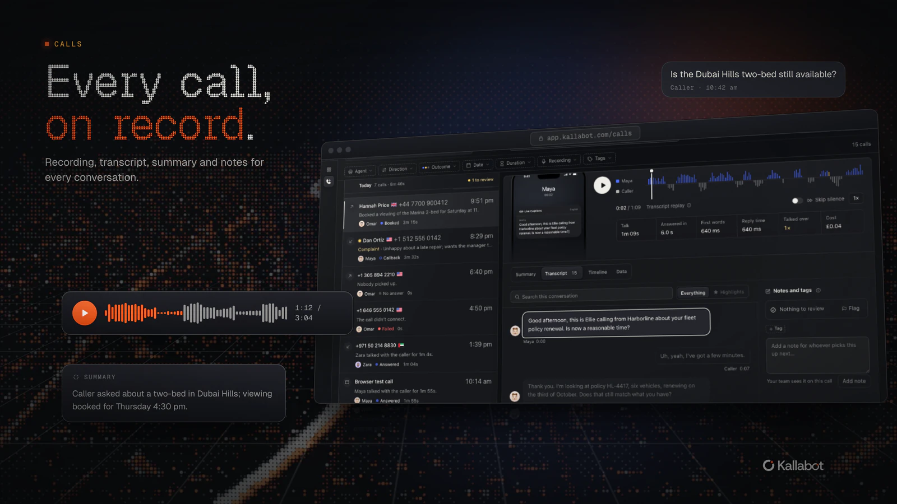
  </Frame>

  ## Webhooks with 35 events

  Every important thing that happens in Kallabot can now reach your systems as a signed webhook.

  <Frame caption="The full webhook catalogue: calls, conversations, agents, knowledge, numbers and tools.">
    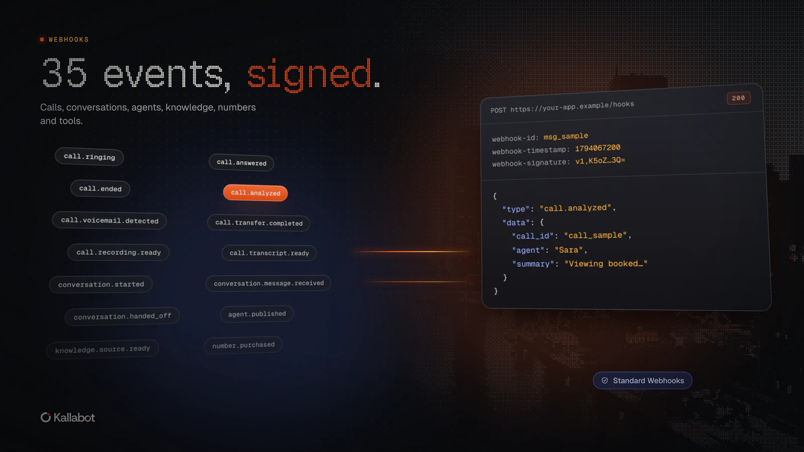
  </Frame>

  - Signed following the [Standard Webhooks](https://www.standardwebhooks.com) specification.
  - Automatic retries, delivery logs, replay and secret rotation with a grace period.
  - See [Webhooks](/developers/webhooks) and the [event catalogue](/developers/events).

  **For developers**

  - A new public API at `https://api.kallabot.com/v1`, generated into a full [API reference](/api-reference/introduction): 126 paths and 164 operations across agents, calls, knowledge, inbox, web chat, numbers, SIP trunks, tools and webhooks.
  - Scoped API keys in the format `kb_live_…`, with expiry, instant revocation and per-key access presets.
  - RFC 9457 problem responses with stable error codes, required `Idempotency-Key` on creates, `If-Match` revisions, cursor pagination and per-key rate limits with `RateLimit-*` headers. See [Errors](/developers/errors).
  - Browser voice calls over WebRTC.

  **Removed**

  The previous API (campaigns, contacts, regulatory and the old agent and call endpoints) and its `sk_` and `bn-` keys have been retired. Contact [contact@kallabot.com](mailto:contact@kallabot.com) if you need help moving over.
</Update>

<Update label="2026-10-31" description="~500 ms voice latency work" tags={["Voice"]} rss={{ title: "~500 ms voice latency work", description: "Pipecat 1.15, earlier first words, a leaner prompt, faster turns and warmed providers, working toward a 500 ms reply." }}>
  ## ~500 ms voice latency work

  Agents now start speaking sooner after the caller finishes, as part of work toward a reply in about half a second.

  <Frame caption="The voice pipeline: hear, understand, think, speak.">
    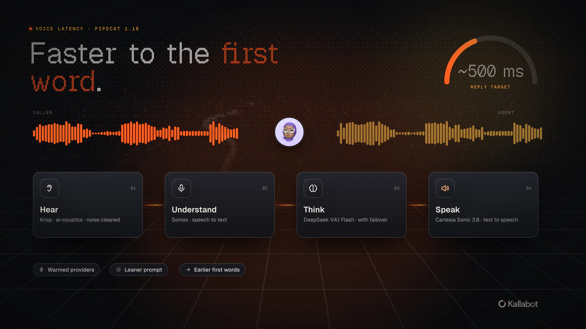
  </Frame>

  - **Pipecat 1.15** underneath, with backchannels the language model can see.
  - **First sound sooner:** the lead-in is trimmed and the first phrase is spoken as soon as it's ready.
  - **Every model provider is warmed when a call starts**, and a stalled request is retried on another.
  - **A leaner hidden prompt** (about a third of its old size) with turn rules first, so undecided turns resolve faster.
  - Cerebras joins the model picker for very fast replies.

  ## Also in this release

  - The agent hangs up only after a real goodbye.
  - A trailing "uh" or a one-word aside no longer cuts the agent off.
  - Another voice in the room is not mistaken for the caller.
  - Cartesia delivery tags (emotion and emphasis) reach the voice in the languages that support them.
</Update>

<Update label="2026-10-28" description="Messenger and Instagram" tags={["Channels"]} rss={{ title: "Messenger and Instagram", description: "Connect a Facebook Page and Instagram account with Meta sign-in; the agent replies to DMs, comments and story mentions." }}>
  ## WhatsApp, Messenger and Instagram inboxes

  Your agent now replies on Facebook Messenger and Instagram, connected with a single Meta sign-in.

  <Frame caption="Where the agent answers: phone, WhatsApp, Messenger, Instagram and web chat on one page.">
    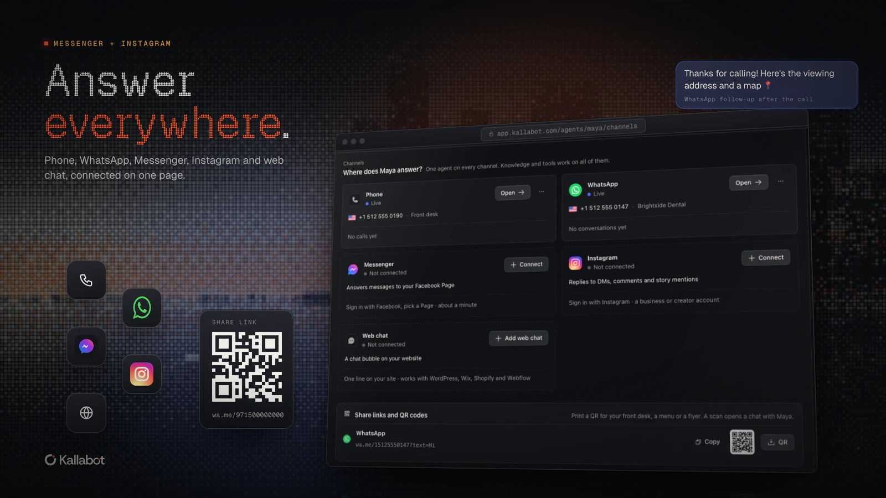
  </Frame>

  - Connect a Facebook Page and an Instagram business account through Meta.
  - The agent answers DMs, turns comments into private replies and responds to story mentions.
  - All of it lands in the same inbox as WhatsApp and web chat, where a person can take over.

  See [Messenger and Instagram](/guides/messenger-instagram) and [Inbox](/guides/inbox).
</Update>

<Update label="2026-10-22" description="Knowledge from websites, PDFs, Word and Google Sheets" tags={["Agents", "Knowledge"]} rss={{ title: "Knowledge from websites, PDFs, Word and Google Sheets", description: "A shared knowledge library, Google Sheets tools and one agent for calls, WhatsApp and web chat." }}>
  ## Knowledge from websites, PDFs, Word and Google Sheets

  Agents now learn from a shared knowledge library that you fill with what you already have.

  <Frame caption="One library of sources, attached to any agent.">
    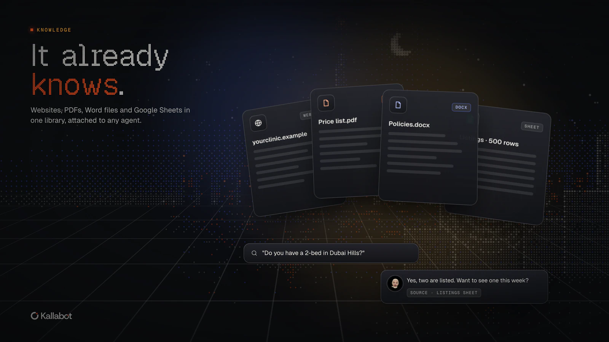
  </Frame>

  - Add a **website**, **PDF**, **Word** (`.docx`), text, Markdown, HTML or CSV file, or a **Google Sheet**.
  - Import listings as a **catalog** (property, cars, products) and the agent can send matching items in chat.
  - Calls start with the agent's knowledge, and Arabic, Hindi and Urdu words stay whole when it's searched.

  See [Knowledge](/guides/knowledge).

  ## Google Sheets tools

  - Connect a Google account or a service account, and let a WhatsApp reply **add a row** to a sheet.
  - Write a note for each column and when to save a row; the agent follows it. See [Tools](/guides/tools).

  ## Also in this release

  - **One agent everywhere:** saving an agent gives it a WhatsApp agent and a website widget that share its setup, with separate words for calls and for chat.
  - Chats the agent closed reopen when the customer writes again.
</Update>

<Update label="2026-10-21" description="Bring your own carrier (SIP) and WhatsApp follow-ups" tags={["Numbers", "Channels"]} rss={{ title: "Bring your own carrier (SIP) and WhatsApp follow-ups", description: "Connect your own SIP trunk or Twilio account, embedded number compliance, and WhatsApp follow-ups after calls." }}>
  ## Bring your own carrier (SIP)

  You can now keep your existing phone carrier or office phone system and let a Kallabot agent answer its calls.

  <Frame caption="Your carrier, a SIP trunk, Kallabot's own edge, and your agent.">
    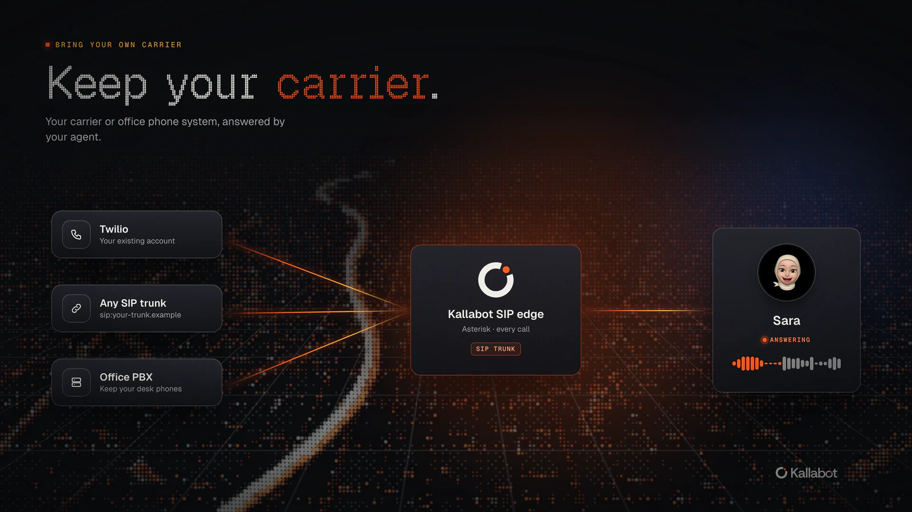
  </Frame>

  - All calls now run through Kallabot's own Asterisk SIP edge.
  - Connect any SIP trunk or office phone system, with live connection status.
  - **Connect a Twilio account in one step:** Kallabot sets up the SIP trunk on your account for you.
  - Live number search and one-step buying, plus forwarding and porting.

  See [Bring your own carrier](/guides/bring-your-own-carrier).

  ## Also in this release

  - **Number compliance** through an embedded verification form, with a separate sub-account for each workspace.
  - **Who answers:** switch which agent answers a number, with a confirm step.
  - **WhatsApp after a phone call:** the agent can send the call's outcome on WhatsApp using an approved template.
  - **WhatsApp replies** can include documents, photos with buttons, and tool calls.
</Update>

<Update label="2026-10-19" description="Workflows builder" tags={["Integrations"]} rss={{ title: "Workflows builder", description: "A visual automation builder at workflows.kallabot.com, connecting Kallabot to hundreds of apps." }}>
  ## Workflows: connect Kallabot to hundreds of apps

  Kallabot Workflows is a drag-and-drop automation builder, built on the open-source Activepieces and running at workflows.kallabot.com.

  <Frame caption="When a call is analysed, add a row, post to Slack and email the summary.">
    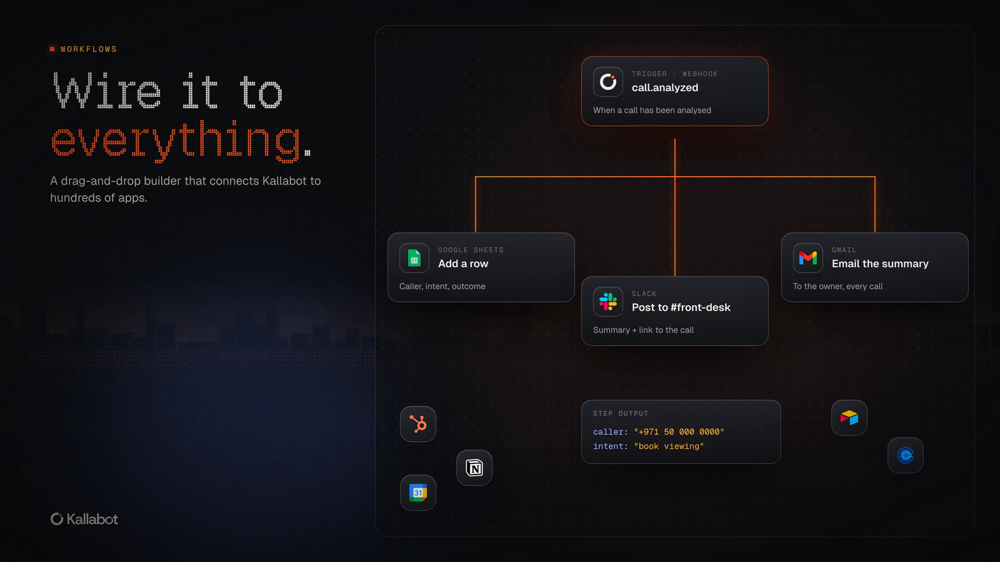
  </Frame>

  - Opens inside Kallabot, already signed in.
  - Connects to Slack, Gmail, HubSpot, Salesforce, Google Sheets, Airtable and hundreds more.
  - Start a workflow from any Kallabot webhook event, such as `call.analyzed`.

  See [Workflows](/guides/workflows).
</Update>

<Update label="2026-10-18" description="WhatsApp agents and inbox" tags={["Channels"]} rss={{ title: "WhatsApp agents and inbox", description: "A WhatsApp studio, Embedded Signup, a shared inbox, catalogs of up to 500 items and message templates." }}>
  ## WhatsApp agents and inbox

  Your agent now runs your WhatsApp Business number, set up in a studio with a live phone preview.

  <Frame caption="The WhatsApp studio: pick the agent, preview the chat, try it for real.">
    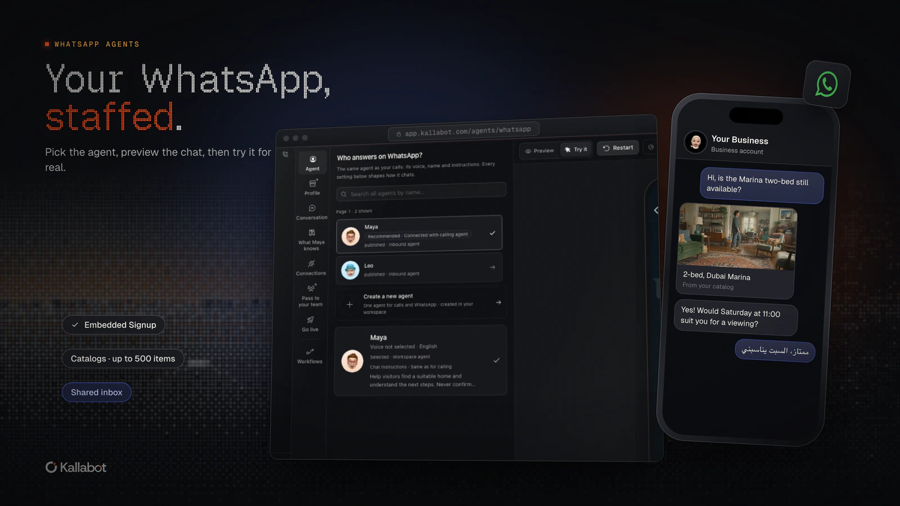
  </Frame>

  - Connect through Meta **Embedded Signup**, including numbers that stay on the WhatsApp Business app.
  - **Try it** talks to the real agent, not a script.
  - **Catalogs** of up to 500 items with size variants and currency; matching items are sent as cards.
  - A shared **inbox** where a teammate can read, reply or take over.
  - **Message templates** for messages outside the 24-hour window.

  See [WhatsApp](/guides/whatsapp).
</Update>

<Update label="2026-10-14" description="Agents that speak Gulf Arabic, Urdu and English" tags={["Voice", "Languages"]} rss={{ title: "Agents that speak Gulf Arabic, Urdu and English, and switch mid-call", description: "Soniox speech recognition, language ID, Krisp noise handling, 16 kHz web audio and call recording." }}>
  ## Agents that speak Gulf Arabic, Urdu and English, and switch mid-call

  Agents now follow callers who move between Gulf Arabic, Urdu and English in the same call, and answer in the language and register they hear.

  <Frame caption="A caller switches from Emirati Arabic to English; the agent follows.">
    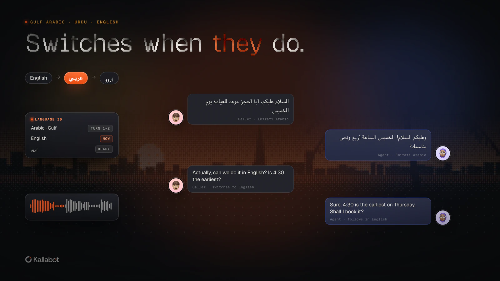
  </Frame>

  - **Soniox** speech recognition chosen after a call-recording bake-off, with language ID and speaker separation.
  - Each reply is pronounced in its own language, with regional accents kept and the street register people really use, English mixed in where locals mix it.
  - **Krisp** noise, turn and interruption handling, plus ai-coustics voice cleaning before transcription.
  - Web calls listen at 16 kHz for clearer speech.
  - **Echo guard:** the agent's own voice leaking back can't interrupt it or become the caller's words.

  ## Also in this release

  - **Call recording** as heard, saved after the call and shown on the call page.
  - The agent can **hang up** once a conversation is over, and checks in on a silent caller first.
  - AssemblyAI Universal is available as a second speech engine per agent.
  - Pipecat upgraded from 1.8 to 1.12.

  See [Agents](/guides/agents).
</Update>

<Update label="September 2026" description="Natural turn-taking and backchannelling" tags={["Voice"]} rss={{ title: "Natural turn-taking and backchannelling", description: "Audible listener sounds on by default, a repaired turn protocol and Pipecat 1.8." }}>
  ## Natural turn-taking and backchannelling

  Agents now make small listener sounds while callers talk and wait for a real pause before replying.

  <Frame caption="Listener sounds while the caller talks, and a reply only when they've finished.">
    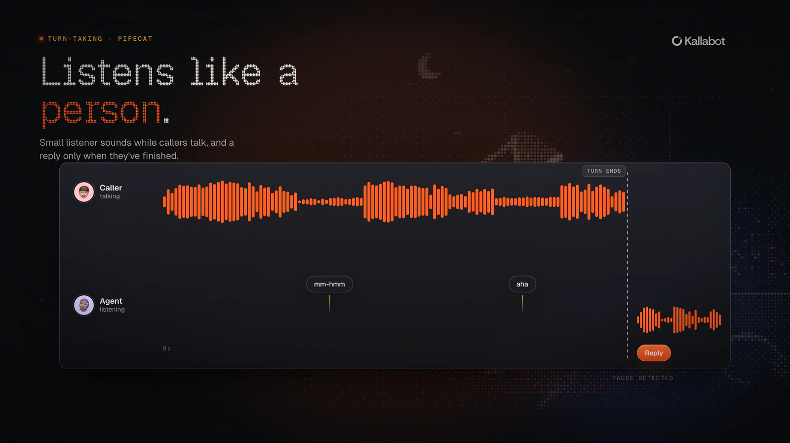
  </Frame>

  - **Backchannelling** is on by default for every agent, timed to the caller's pauses.
  - A repaired turn protocol that no longer holds back complete answers.
  - Hesitation where real thinking happens, so replies sound considered, not scripted.
  - Pipecat upgraded to 1.8.1, with tunable voice activity timing.

  ## Also in this release

  - A closed workspace is never served from a cache or a stale sign-in check.
  - Better call summaries.
</Update>

<Update label="August 2026" description="Tools, MCP, browser calls and the new control plane" tags={["Developers", "Voice"]} rss={{ title: "Tools, MCP, browser calls and the new control plane", description: "API tools, MCP servers, WebRTC browser calls with authenticated TURN, OpenTelemetry and a perception layer that hears tone." }}>
  ## Tools, MCP servers and browser calls

  Agents can now use tools during a conversation, and anyone can talk to an agent from a web page.

  <Frame caption="Tools and MCP servers in calls, and browser voice over WebRTC.">
    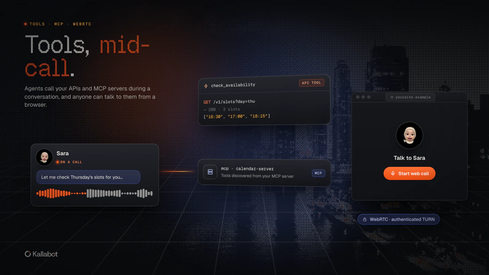
  </Frame>

  - **API tools** call your own endpoints mid-conversation, with stored credentials.
  - **MCP tools:** connect a Model Context Protocol server and choose which of its actions the agent may use.
  - **Browser web calls** over WebRTC, relayed through authenticated TURN, with a full session lifecycle.
  - **Call transfer** to a person.
  - **OpenTelemetry** tracing across every call.

  ## Also in this release

  - The agent hears tone (a laugh, a cough, anger), not just words.
  - Turn-taking that decides on how long the caller spoke, not on word lists.
  - What the agent actually said is tracked separately from what the model wrote, so transcripts are truthful.
  - A new control plane with a canonical schema, the foundation for the public API.
</Update>

<Update label="2025 to mid-2026" description="Earlier releases" tags={["Product"]} rss={{ title: "Earlier releases", description: "Sign-in with an emailed code, the live calls globe, browser demo calls and the first agents suite." }}>
  ## Earlier releases

  Before the rebuild, Kallabot shipped the foundations that the current platform grew from.

  - **Sign in with a six-digit emailed code**, with email and password as an option (July 2026).
  - **A live calls globe** and activity charts on the dashboard (August 2026).
  - **The first agents suite** with templates, sorting and filtering (May to June 2026).
  - **Workflows** embedded in the app for the first time (March 2026).
  - **Try an agent in the browser:** demo web calls on kallabot.com (September 2025).
</Update>
