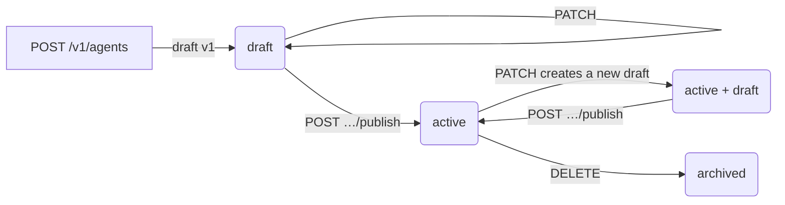

An agent is a versioned JSON config: who it is, how it sounds, how it listens, what it knows and what it can do. The same agent answers your phone numbers, places outbound calls, takes browser calls and replies on chat channels.

## The lifecycle



- **Draft.** Every save writes a draft version. Callers never hear a draft.
- **Publish.** Makes the current draft the live version. From then on, new calls and chats use it. Calls already in progress keep the version they started with.
- **Versions.** Every published version is kept. `GET /v1/agents/{agent_id}/versions` lists them, and `POST …/versions/{version_id}/revert` turns an old one into a new draft.
- **Archive.** `DELETE` archives the agent, with a required `reason`. It's never a hard delete, because calls and audit records still point at it. Archived agents stop taking calls and drop out of the default list.

The agent object tells you where it stands:

| Field | Meaning |
| --- | --- |
| `status` | `draft` (never published), `active`, `suspended` or `archived`. |
| `published_version` | The version callers hear, or `null`. |
| `draft_version` | The unpublished draft, or `null` when there's nothing waiting. |
| `has_unpublished_changes` | `true` when a draft differs from what's live. |
| `revision` | Goes up on every change. Send it in `If-Match`. See [Concurrency](/developers/concurrency). |
| `capabilities` | What **your key** may do to **this** agent: `can_edit`, `can_publish`, `can_archive`, `can_call`. |
| `config` | The draft config if there is one, else the published one. |
| `findings` | Warnings and errors from the last compile. See [Validate](#validate-before-you-save). |

## A complete config

Every field is optional and has a server default. The smallest valid agent is `{"config": {"prompt": "…"}}`. A realistic one:

```json
{
  "config": {
    "name": "Front desk",
    "prompt": "You answer the phone for Bright Smile Dental in Dubai Marina. Help callers book a cleaning or a check-up, and answer questions about prices from the knowledge base. If someone is in pain, offer the first slot today. Never give medical advice.",
    "greeting": "Hi, thanks for calling Bright Smile Dental. How can I help?",
    "outbound_greeting": "Hi, it's Bright Smile Dental calling about your appointment.",
    "greeting_mode": "fixed",
    "language": "en",
    "timezone": "Asia/Dubai",
    "stt": {
      "languages": ["ar", "hi", "ur"],
      "context": { "terms": ["Invisalign", "Dr Al Mansouri", "scale and polish"] }
    },
    "tts": { "voice": "c961b81c-a935-4c17-bfb3-ba2239de8c2f", "speed": 1.0 },
    "call": {
      "direction": "both",
      "max_duration_sec": 900,
      "record": true,
      "voicemail": { "enabled": true, "message": "Hi, it's Bright Smile Dental. Please call us back on 04 123 4567. Thank you!" },
      "monitoring_notice": { "enabled": true }
    },
    "knowledge": { "ids": ["7e6d5c4b-3a29-4180-9f7e-6d5c4b3a2918"], "mode": "auto" },
    "tools": [{ "tool_id": "3c2b1a0f-9e8d-4c7b-a6f5-e4d3c2b1a0f9" }],
    "builtins": {
      "calendar": {
        "google_connection_id": "5a1c7e2b-0d4f-4b8a-9c3e-6f1a2b3c4d5e",
        "calendar_id": "primary",
        "duration_min": 30,
        "min_notice_min": 120
      }
    },
    "web_search": { "enabled": true, "domains": ["dha.gov.ae"] },
    "analysis": {
      "successDefinition": "The caller booked an appointment.",
      "dispositionLabels": ["booked", "price_question", "callback", "not_interested"],
      "extractFields": [
        { "key": "patient_name", "type": "string", "description": "The patient's full name" },
        { "key": "preferred_day", "type": "date" }
      ]
    },
    "metadata": { "crm_account": "acc_8812" }
  }
}
```

## Config reference

The full schema, with every field and its limits, is in the [API reference](/api-reference/introduction) under **Agents**. The blocks you'll use most:

<AccordionGroup>
  <Accordion title="Identity: name, prompt, greeting, language, timezone" icon="user-round">
    | Field | Default | Notes |
    | --- | --- | --- |
    | `name` | `"Inline agent"` | Shown in the dashboard. A URL-safe `slug` is made from it. |
    | `prompt` | A generic phone assistant | Who the agent is, its job and its rules. Kallabot adds its own short voice guidance on top, so write about your business, not about how to talk on the phone. |
    | `greeting` | `"Hi! How can I help?"` | The opening line. `null` means the agent writes its own. |
    | `outbound_greeting` | uses `greeting` | The opening line on calls the agent places. Worth setting: an inbound opener on an outbound call confuses people. |
    | `greeting_mode` | `fixed` | `fixed` says the exact words (fastest). `dynamic` treats `greeting` as a brief and writes the opener for each caller, at the cost of one model call before the first word. |
    | `language` | `en` | The agent's main language, as a language code (`en`, `ar`, `hi`, `ur`…). |
    | `timezone` | none | IANA zone, like `Asia/Dubai`. Used whenever the agent talks about times. |
  </Accordion>

  <Accordion title="Listening: stt" icon="ear">
    Speech recognition. The defaults are tuned for Gulf callers who switch between English, Arabic, Urdu and Hindi mid-sentence.

    | Field | Notes |
    | --- | --- |
    | `language`, `languages` | The main language and others to expect. Fewer languages means better accuracy. |
    | `strict_language` | On by default. Keeps accented English from coming back in another script. |
    | `context.terms` | Words to expect: staff names, products, medications. The single biggest accuracy win. |
    | `context.general` | Up to ten short facts, like `{"domain": "Dental clinic", "location": "Dubai"}`. |
    | `clarify_below` | When recognition confidence drops below this (try `0.65`), the agent asks the caller to repeat instead of guessing. |
    | `addressivity` | What to do with speech not aimed at the agent, like the caller talking to someone in the room: `retain` (default, stay quiet but remember it), `ignore` or `off`. |
  </Accordion>

  <Accordion title="Speaking: tts" icon="audio-lines">
    The voice. Voices come from Cartesia (model `sonic-3.6`). The easiest way to pick one is in the dashboard's voice picker, where you can hear each voice and clone your own; then copy its id into `tts.voice`.

    | Field | Notes |
    | --- | --- |
    | `voice` | The voice id. |
    | `speed` | `0.6` to `1.5`. `1.0` is natural speed. |
    | `volume` | `0.5` to `2.0`. |
    | `emotion` | A baseline emotion for English voices, like `calm` or `content`. |
    | `pronunciation_dict_id` | A Cartesia pronunciation dictionary for names the voice gets wrong. |
  </Accordion>

  <Accordion title="Turn-taking: turn and style" icon="messages-square">
    When the agent decides the caller has finished, and how human it sounds.

    | Field | Default | Notes |
    | --- | --- | --- |
    | `turn.strategy` | `semantic` | An acoustic model plus a check that the thought is finished, so the agent doesn't jump in while someone reads out a phone number. |
    | `turn.interruptible` | `true` | Callers can talk over the agent. |
    | `turn.min_interrupt_words` | `2` | "Mm-hm" and "yeah" don't count as interrupting. |
    | `turn.protect_greeting` | `true` | Ignores line noise until the greeting has played. |
    | `turn.idle_timeout_sec` | off | Seconds of silence before the agent checks the caller is still there. |
    | `style.backchanneling` | `true` | Short "mm-hm"s while the caller talks at length. |
    | `style.disfluency` | `true` | Natural fillers and self-corrections. Turn off for a flat, scripted read-out. |
    | `style.avoid_tells` | `true` | Stops robotic habits, like reading URLs aloud. The agent never claims to be human when asked directly. |
  </Accordion>

  <Accordion title="The call: call" icon="phone">
    | Field | Default | Notes |
    | --- | --- | --- |
    | `direction` | `outbound` | `inbound`, `outbound` or `both`: where the agent may be used. |
    | `max_duration_sec` | `600` | Hard limit, 10 to 7200 seconds. |
    | `record` | `false` | Keep a recording of the call. |
    | `end_call` | `true` | The agent may hang up once the conversation is clearly over. |
    | `summarize_long_calls` | `true` | On very long calls, older turns are summarized so the agent doesn't forget the caller's name. |
    | `voicemail` | off | Outbound only. `{"enabled": true, "message": "…"}` leaves `message` on an answering machine and hangs up. See [voicemail](/guides/voicemail). |
    | `monitoring_notice` | off | Says a short "this call may be recorded or monitored" line before the greeting. Set your own words in `text`. |
    | `transfer` | off | Named destinations the agent may transfer to. See below. |
  </Accordion>

  <Accordion title="What it knows and can do: knowledge, tools, builtins, web_search" icon="wrench">
    | Field | Notes |
    | --- | --- |
    | `knowledge.ids` | Knowledge sources to answer from. Add them in the dashboard or with [`POST /v1/knowledge/sources`](/developers/knowledge). |
    | `knowledge.mode` | `auto` (default) puts small libraries straight into the agent's instructions and searches big ones each turn. `prompt` or `search` forces one. |
    | `knowledge.channels` | Per source, which channels it answers on (`phone`, `web`, `whatsapp`, `instagram`, `messenger`, `web_chat`). |
    | `tools` | Saved tools by reference: `{"tool_id": "…"}`. Create them first with `POST /v1/tools`. Optional `channels`, `allowed_tools` (for an MCP server) and `overrides` (`filler`, `timeout_ms`). |
    | `builtins.calendar` | Check free times and book on a connected Google Calendar. Takes `google_connection_id`, `calendar_id`, `duration_min`, opening `hours` (Monday to Sunday) and `min_notice_min`. |
    | `builtins.sheets` | Look up rows in a connected Google Sheet. |
    | `builtins.knowledge_search` | Let the agent search knowledge on demand. |
    | `web_search` | Let the agent search the web itself. Limit it to `domains` if you like, and cap `max_per_call`. |

    Google connections are made in the dashboard; their ids come from there.
  </Accordion>

  <Accordion title="After the conversation: analysis" icon="clipboard-check">
    What the summary step looks for once a call or chat ends. Results arrive on the call (`disposition`, `summary`, `extracted`) and in the `call.analyzed` webhook.

    | Field | Notes |
    | --- | --- |
    | `successDefinition` | In one sentence, what a good outcome is. |
    | `dispositionLabels` | Up to 20 labels; each conversation gets one. |
    | `extractFields` | Up to 20 fields to pull out: `key` (lowercase, underscores), `type` (`string`, `number`, `boolean`, `date`, `phone`, `email`) and a `description`. |
  </Accordion>

  <Accordion title="Your own data: metadata" icon="tag">
    Any JSON you like. It's echoed back on every call record, so you can tie calls to your own systems.
  </Accordion>
</AccordionGroup>

### Transfers

`call.transfer` lists the people the agent may hand a phone call to. The agent picks by `id` and never dials a number a caller gives it.

```json
"transfer": {
  "enabled": true,
  "destinations": [
    {
      "id": "reception",
      "label": "Reception",
      "to": "+97143334444",
      "mode": "cold",
      "description": "When the caller asks for a person, or has a billing question."
    }
  ],
  "failure_message": "Sorry, reception isn't picking up. Can I take a message?"
}
```

<Note>
  Transfers need Kallabot's call bridge on your phone line. It's rolling out workspace by workspace; where it isn't on yet, the agent tells callers it can't transfer them and offers a call back instead.
</Note>

### Fields that are refused

A config that asks for something the runtime doesn't do yet is refused with `422 unsupported_capability`, never silently ignored. Today that's `memory` (cross-call memory) and a `webhooks` block (webhooks are set up with [`POST /v1/webhooks`](/developers/webhooks) instead). Unknown fields are refused with `invalid_request`.

## Validate before you save

`POST /v1/agents/validate` compiles a config exactly as a save would, without saving it. It returns every finding and the config with all defaults filled in.

```bash
curl https://api.kallabot.com/v1/agents/validate \
  -H "Authorization: Bearer $KALLABOT_API_KEY" \
  -H "Content-Type: application/json" \
  -d '{"config": {"prompt": "You book viewings for Marina Homes.", "call": {"voicemail": {"enabled": true}}}}'
```

```json
{
  "valid": false,
  "config_hash": "9c1e…",
  "findings": [
    {
      "severity": "error",
      "code": "voicemail_message_required",
      "path": "/call/voicemail/message",
      "message": "Write the message the agent leaves on voicemail before turning this on.",
      "provider": null
    }
  ],
  "resolved": { "prompt": "You book viewings for Marina Homes.", "language": "en", "turn": { "strategy": "semantic" } }
}
```

`path` is a JSON Pointer into your config, so an editor can show each finding on its field. Errors block publishing; warnings don't.

## Common tasks

<Tabs>
  <Tab title="Edit and publish">
    ```bash
    # 1. Read: note the ETag
    curl -i https://api.kallabot.com/v1/agents/$AGENT_ID -H "Authorization: Bearer $KALLABOT_API_KEY"

    # 2. Save a new draft (config replaces the whole draft config)
    curl -X PATCH https://api.kallabot.com/v1/agents/$AGENT_ID \
      -H "Authorization: Bearer $KALLABOT_API_KEY" -H "Content-Type: application/json" \
      -H 'If-Match: "4"' -H "Idempotency-Key: $(uuidgen)" \
      -d '{"config": { ... }, "change_note": "Ramadan hours"}'

    # 3. Publish the draft, with the new ETag
    curl -X POST https://api.kallabot.com/v1/agents/$AGENT_ID/publish \
      -H "Authorization: Bearer $KALLABOT_API_KEY" \
      -H 'If-Match: "5"' -H "Idempotency-Key: $(uuidgen)"
    ```
  </Tab>
  <Tab title="Roll back">
    ```bash
    # Find the version to go back to
    curl https://api.kallabot.com/v1/agents/$AGENT_ID/versions -H "Authorization: Bearer $KALLABOT_API_KEY"

    # Make it the draft, then publish as usual
    curl -X POST https://api.kallabot.com/v1/agents/$AGENT_ID/versions/$VERSION_ID/revert \
      -H "Authorization: Bearer $KALLABOT_API_KEY" \
      -H 'If-Match: "6"' -H "Idempotency-Key: $(uuidgen)"
    ```
  </Tab>
  <Tab title="Archive">
    ```bash
    curl -X DELETE https://api.kallabot.com/v1/agents/$AGENT_ID \
      -H "Authorization: Bearer $KALLABOT_API_KEY" -H "Content-Type: application/json" \
      -H 'If-Match: "7"' -H "Idempotency-Key: $(uuidgen)" \
      -d '{"reason": "Replaced by the new front desk agent"}'
    ```
  </Tab>
  <Tab title="List and search">
    ```bash
    curl "https://api.kallabot.com/v1/agents?search=front&direction=inbound&limit=50" \
      -H "Authorization: Bearer $KALLABOT_API_KEY"
    ```

    Filters: `status`, `direction`, `owner`, `team`, `search`. Archived agents only appear with `status=archived`.
  </Tab>
</Tabs>

## Webhooks for agents

`agent.created`, `agent.updated`, `agent.published` and `agent.archived` fire on every change, from the API or the dashboard. See [Events](/developers/events#agents).
