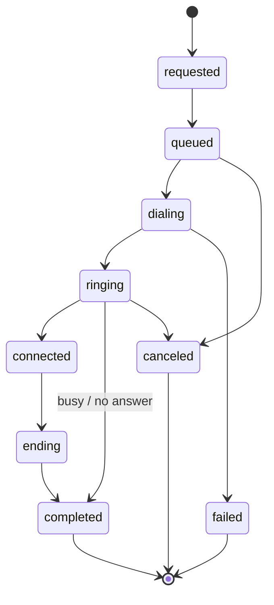

A call is one conversation between an agent and a person, on the phone or in a browser. Inbound calls to your numbers and outbound calls you place show up in the same place: `GET /v1/calls`.

## Place a call

<CodeGroup>
```bash curl
curl https://api.kallabot.com/v1/calls \
  -H "Authorization: Bearer $KALLABOT_API_KEY" \
  -H "Content-Type: application/json" \
  -H "Idempotency-Key: 2b9e6c1d-7f30-4a8e-b5d2-0c4f1a9e3b67" \
  -d '{
    "agent_id": "8f0e4c1a-3b7d-4e2f-9a61-2c5d8b7e1f30",
    "to": "+971501234567",
    "from": "+97142345678",
    "variables": { "first_name": "Sara", "purpose": "confirm her cleaning on Saturday at 11" },
    "metadata": { "booking_id": "bk_4471" },
    "client_ref": "booking-4471-reminder"
  }'
```

```typescript Node SDK
import Kallabot from "@kallabot/sdk";
const kallabot = new Kallabot(); // reads KALLABOT_API_KEY

const call = await kallabot.calls.create(
  {
    agent_id: "8f0e4c1a-3b7d-4e2f-9a61-2c5d8b7e1f30",
    to: "+971501234567",
    from: "+97142345678",
    variables: { first_name: "Sara", purpose: "confirm her cleaning on Saturday at 11" },
    metadata: { booking_id: "bk_4471" },
    client_ref: "booking-4471-reminder",
  },
  { idempotencyKey: "booking-4471-reminder" }, // optional: the SDK makes one for you
);
```

```python Python SDK
from kallabot import Kallabot
client = Kallabot()  # reads KALLABOT_API_KEY

call = client.calls.create(
    agent_id="8f0e4c1a-3b7d-4e2f-9a61-2c5d8b7e1f30",
    to="+971501234567",
    from_="+97142345678",
    variables={"first_name": "Sara", "purpose": "confirm her cleaning on Saturday at 11"},
    metadata={"booking_id": "bk_4471"},
    client_ref="booking-4471-reminder",
    idempotency_key="booking-4471-reminder",  # optional: the SDK makes one for you
)
```
</CodeGroup>

| Field | Required | Notes |
| --- | --- | --- |
| `agent_id` | Yes | A published agent whose `call.direction` allows outbound. |
| `to` | Yes | E.164, like `+971501234567`. Emergency numbers are always refused. |
| `from` | No | One of your active numbers that can call out. Default: the agent's own caller number, then the oldest number in its branch. |
| `variables` | No | Up to 50 facts the agent is told at the start of the call, one line each (`first_name: Sara`). A `purpose` variable tells the agent why it's calling, so it can answer "why are you calling me?". |
| `metadata` | No | Up to 50 keys of your own data, stored on the call. The agent never sees it. |
| `client_ref` | No | Your own reference, up to 120 characters. |
| `test_mode` | No | `true` lets you call an agent that hasn't been published yet (it uses the latest draft). The call is marked as a test. |

The answer is `202 Accepted`: the call is created and dialling starts right away. It carries the call's `id` (`call_…`), an `ETag` and a `Location` header.

```json
{
  "id": "call_5f0a1c9e2b7d4a8e3c6f1b0d",
  "channel": "phone",
  "direction": "outbound",
  "lifecycle": "queued",
  "outcome": null,
  "revision": 2,
  "agent_id": "8f0e4c1a-3b7d-4e2f-9a61-2c5d8b7e1f30",
  "agent_version": 3,
  "party": "+97150•••4567",
  "party_country": "AE",
  "requested_at": "2026-11-07T09:30:00.120Z",
  "answered_at": null,
  "ended_at": null,
  "attempt_count": 0,
  "has_recording": false,
  "has_transcript": false,
  "analysis_state": "pending",
  "capabilities": { "can_cancel": true, "can_listen": false, "can_read_transcript": false, "can_export": false }
}
```

### Before a call is placed

The request is refused up front, before anything dials, when:

| Code | Why |
| --- | --- |
| `agent_not_published` (409) | The agent has no published version. Publish it or send `test_mode: true`. |
| `no_caller_id` (409) | The workspace has no number that can call out. |
| `party_suppressed`, `consent_withdrawn` (403) | The number is on your suppression list, or the person opted out. |
| `insufficient_credit` (402) | No minutes left. |
| `capacity_exceeded` (429) | Too many calls already running at once. Retry after `Retry-After`. |

## The lifecycle



`lifecycle` is where the call is now. Once it reaches `completed`, `failed` or `canceled` it never changes again, and `outcome` says how it went:

| `outcome` | Meaning |
| --- | --- |
| `answered` | Someone picked up and the agent talked to them. |
| `busy`, `no_answer`, `rejected` | Nobody took the call. |
| `abandoned` | The caller hung up before the agent answered. |
| `canceled` | You (or a teammate) cancelled it. |
| `provider_failed`, `runtime_failed` | The carrier, or our side, failed. |
| `unknown` | We couldn't tell. |

`terminal_reason` adds detail, like `remote_hangup` or `max_duration`.

<Tip>
  Don't poll. Subscribe to `call.ringing`, `call.answered` and `call.ended` webhooks instead. See [Events](/developers/events#calls).
</Tip>

## Read a call

`GET /v1/calls/{call_id}` returns everything about one call: timings, latency, minutes, analysis, transfers and recordings.

| Group | Fields |
| --- | --- |
| Timing | `requested_at`, `answered_at`, `ended_at`, `ring_ms`, `talk_ms`, `total_ms` |
| Responsiveness | `first_audio_ms`, `response_p50_ms`, `response_p95_ms`, `turn_count`, `interruption_count` |
| Analysis | `analysis_state`, `disposition`, `sentiment_label`, `summary`, `extracted`, `callback_at`, `caller_name` |
| Minutes | `reserved_minutes`, `billed_minutes`, `billed_transfer_minutes`, `usage_finalization` |
| Transfers and teammates | `transferred`, `transfers`, `operator_sessions` |
| Media | `has_recording`, `has_transcript`, `recordings` |
| Yours | `variables`, `metadata`, `client_ref` |

Fields with conversation content (`summary`, `caller_name`, `extracted`, unmasked `from_e164` and `to_e164`, `recordings`) are `null` or empty unless your key has `call:content`. Without it, the other party is always masked, like `+97150•••4567`.

Minutes and cost settle shortly after the call ends. Until `usage_finalization` and `cost_finalization` say `complete`, treat those numbers as estimates.

### List and filter

```bash
curl "https://api.kallabot.com/v1/calls?direction=inbound&since=2026-11-01T00:00:00Z&disposition=booked&limit=100" \
  -H "Authorization: Bearer $KALLABOT_API_KEY"
```

Filters include `lifecycle`, `outcome`, `agent_id`, `channel` (`phone` or `web`), `direction`, `attention`, `since`, `until`, `disposition`, `sentiment`, `tags`, `has_recording`, `talk_ms_min`, `talk_ms_max`, `q` (search), `test_mode` and `archived` (`false` by default, `true` or `all`). Results are newest first; see [Pagination](/developers/pagination).

`GET /v1/calls/export` returns the same filtered list as CSV and needs `call:export`.

## Transcript and recording

Both need `call:content`. Reading a transcript is recorded in the workspace's audit log.

```bash
curl https://api.kallabot.com/v1/calls/call_5f0a1c9e2b7d4a8e3c6f1b0d/transcript \
  -H "Authorization: Bearer $KALLABOT_API_KEY"
```

```json
{
  "call_id": "call_5f0a1c9e2b7d4a8e3c6f1b0d",
  "turns": [
    { "turn_index": 0, "speaker": "agent", "start_offset_ms": 900, "end_offset_ms": 3400, "language": "en", "interrupted": false, "transcript": "Hi, it's Bright Smile Dental calling about your appointment." },
    { "turn_index": 1, "speaker": "user", "start_offset_ms": 3900, "end_offset_ms": 5100, "language": "en", "confidence": 0.94, "interrupted": false, "transcript": "Oh hi, yes." }
  ]
}
```

Each turn also carries timing (`silence_before_ms`, `stt_latency_ms`, `llm_ttft_ms`, `tts_ttfb_ms`, `end_to_end_ms`) for debugging how fast the agent answered.

`GET /v1/calls/{call_id}/recording` returns the audio as `audio/wav` and supports HTTP range requests, so an `<audio>` element can seek. Add `?kind=call` for the whole call (including transfers and teammates), or `?kind=agent` for the agent's part only. Recordings exist only when the agent has `call.record: true`.

The `call.transcript.ready`, `call.recording.ready` and `call.analyzed` webhooks tell you when each is available.

## Cancel or hang up

`POST /v1/calls/{call_id}/cancel` stops a call that's still ringing, or hangs up a live one. It needs `call:control`, an `Idempotency-Key` and a short `reason`. `If-Match` is optional.

```bash
curl -X POST https://api.kallabot.com/v1/calls/call_5f0a1c9e2b7d4a8e3c6f1b0d/cancel \
  -H "Authorization: Bearer $KALLABOT_API_KEY" -H "Content-Type: application/json" \
  -H "Idempotency-Key: $(uuidgen)" \
  -d '{"reason": "Customer already booked online"}'
```

The response is `202`: the hang-up is queued, and `lifecycle` moves when the carrier confirms.

## Tag, review and annotate

`PATCH /v1/calls/{call_id}` (needs `call:annotate` and `If-Match`) sets `tags`, `attention` (`none`, `needs_review`, `reviewed`) and `archived`. Send only what changes.

```bash
curl -X PATCH https://api.kallabot.com/v1/calls/call_5f0a1c9e2b7d4a8e3c6f1b0d \
  -H "Authorization: Bearer $KALLABOT_API_KEY" -H "Content-Type: application/json" \
  -H 'If-Match: "9"' \
  -d '{"tags": ["vip", "follow-up"], "attention": "reviewed"}'
```

## Live control

While a call is `connected`, these act on it:

| Endpoint | What it does | Key |
| --- | --- | --- |
| `POST /v1/calls/{call_id}/whisper` | Sends the agent a private note (`{"text": "Offer the 4pm slot"}`). It reads the note before its next answer and never says it aloud. | Personal |
| `POST /v1/calls/{call_id}/operator` | Listen in (`listen`), take over from a browser (`takeover`), or take the call on your own phone (`phone_takeover`, with `phone`). `listen` and `takeover` return a short-lived `monitor.path` for the audio WebSocket. | Personal |
| `DELETE /v1/calls/{call_id}/operator` | Stop listening, or hand the call back to the agent. | Personal |
| `POST /v1/calls/{call_id}/transfer` | Move the caller to one of the agent's named destinations (`destination_id`), or to a typed number (`to`). The result arrives as `call.transfer.completed` or `call.transfer.failed`. | Workspace or personal for `destination_id`; personal for `to` |

All four need `call:read` and `call:control`. The call's `capabilities` (`can_whisper`, `can_operate`, `can_transfer`) say which ones work right now for that call.

### Live control through the API

Live control acts as a person, so it's logged under their name. Use a [personal key](/developers/authentication#two-kinds-of-key) (`kbp_live_…`): a workspace key gets `403 personal_key_required`. The one exception is transferring to the agent's own approved destinations, which an automation may do with a workspace key, for example when your system decides a VIP caller should reach a manager:

<CodeGroup>
```bash curl
curl -X POST https://api.kallabot.com/v1/calls/call_5f0a1c9e2b7d4a8e3c6f1b0d/transfer \
  -H "Authorization: Bearer $KALLABOT_API_KEY" -H "Content-Type: application/json" \
  -H "Idempotency-Key: $(uuidgen)" \
  -d '{"destination_id": "reception"}'
```

```typescript Node SDK
await kallabot.calls.transfer("call_5f0a1c9e2b7d4a8e3c6f1b0d", { destination_id: "reception" });
```

```python Python SDK
client.calls.transfer("call_5f0a1c9e2b7d4a8e3c6f1b0d", destination_id="reception")
```
</CodeGroup>

With a teammate's personal key, tell the agent something mid-call:

<CodeGroup>
```bash curl
curl -X POST https://api.kallabot.com/v1/calls/call_5f0a1c9e2b7d4a8e3c6f1b0d/whisper \
  -H "Authorization: Bearer $KALLABOT_PERSONAL_KEY" -H "Content-Type: application/json" \
  -H "Idempotency-Key: $(uuidgen)" \
  -d '{"text": "She is a returning patient, offer the 4pm slot"}'
```

```typescript Node SDK
const teammate = new Kallabot({ apiKey: process.env.KALLABOT_PERSONAL_KEY }); // kbp_live_…
await teammate.calls.whisperToAgent("call_5f0a1c9e2b7d4a8e3c6f1b0d", {
  text: "She is a returning patient, offer the 4pm slot",
});
```

```python Python SDK
teammate = Kallabot(api_key=os.environ["KALLABOT_PERSONAL_KEY"])  # kbp_live_…
teammate.calls.whisper("call_5f0a1c9e2b7d4a8e3c6f1b0d", text="She is a returning patient, offer the 4pm slot")
```
</CodeGroup>

<Note>
  Listening in, taking over and transferring **phone** calls need Kallabot's call bridge on the line, which is rolling out workspace by workspace. Browser calls support listening in and taking over everywhere. When an action isn't available, its capability is `false` and the endpoint answers `409`.
</Note>

## Schedule a call for later

`POST /v1/scheduled-calls` books an outbound call for a set time. Kallabot dials it at that moment, through the same checks as `POST /v1/calls`.

```bash
curl https://api.kallabot.com/v1/scheduled-calls \
  -H "Authorization: Bearer $KALLABOT_API_KEY" -H "Content-Type: application/json" \
  -H "Idempotency-Key: $(uuidgen)" \
  -d '{
    "agent_id": "8f0e4c1a-3b7d-4e2f-9a61-2c5d8b7e1f30",
    "to": "+971501234567",
    "run_at": "2026-11-09T10:30:00+04:00",
    "timezone": "Asia/Dubai",
    "reason": "Reminder for Saturday cleaning",
    "variables": { "first_name": "Sara" }
  }'
```

- `run_at` must include a UTC offset (`+04:00` or `Z`), be at least 30 seconds away and within a year.
- `timezone` (an IANA name, default `UTC`) is the callee's zone, used when showing and moving the call.
- The agent must be published, and the number is checked against your suppression list when you book and again when it dials.

A scheduled call has a `state`:

| `state` | Meaning |
| --- | --- |
| `proposed` | A callback the caller asked for during a call. It **never dials on its own**: confirm it with `POST /v1/scheduled-calls/{scheduled_call_id}/confirm` (optionally with a new `run_at`). |
| `scheduled` | Will dial at `run_at`. Move it with `PATCH` or stop it with `POST …/cancel`. |
| `dialing` | The call is being placed. `call_id` links to it. |
| `done` | The call happened. |
| `failed`, `canceled` | Finished without a call. `last_error` says why. |

If nobody answers (or the line fails), Kallabot tries again a little later, a limited number of times. If a call can't be dialled near its time at all (for example, every call slot stays busy for 30 minutes), it goes back to `proposed` so a person can pick a new time rather than ringing someone hours late.

## Tool runs and events

- `GET /v1/calls/{call_id}/tool-invocations`: every tool the agent used on the call, with its result and timing.
- `GET /v1/calls/{call_id}/events`: the call's full event trail, in order. Page with `after_seq`. A gap in `seq` means some events were dropped under load; `completeness` says so.
