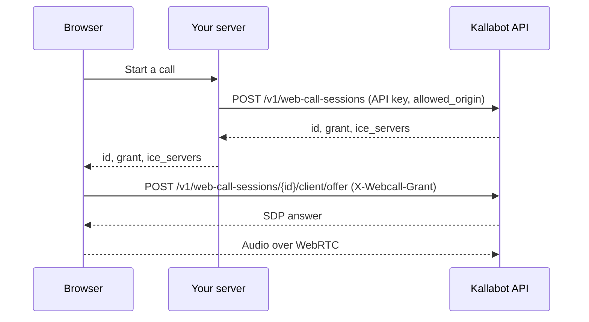

A web call is a voice call between a browser and an agent. It's a real call: it shows up in `GET /v1/calls` with `channel: "web"`, uses minutes, is recorded and analysed like a phone call, and fires the same webhooks.

<Tip>
  Just want a talk button on your website? The [web chat widget](/guides/web-chat) already includes voice, with one script tag and no code. Use the API when you want voice inside your own app or page.
</Tip>

## How it fits together



Your API key never leaves your server. The browser gets a **grant**: a short-lived, single-use credential that can only connect this one call, and only from the website you named.

| Step | Endpoint | Auth |
| --- | --- | --- |
| 1. Create a session (server) | `POST /v1/web-call-sessions` | API key with `webcall:create`, plus `Idempotency-Key` |
| 2. Send the offer (browser) | `POST /v1/web-call-sessions/{call_id}/client/offer` | `X-Webcall-Grant` only |
| 3. Trickle ICE (browser, optional) | `PATCH /v1/web-call-sessions/{call_id}/client/offer` | `X-Webcall-Grant` only |
| Hang up (browser) | `DELETE /v1/web-call-sessions/{call_id}/client` | `X-Webcall-Grant` only |

## 1. Create the session on your server

Set `allowed_origin` to the exact origin of the page that will connect, like `https://your.site`. Only that page can use the grant.

<CodeGroup>
```bash curl
curl https://api.kallabot.com/v1/web-call-sessions \
  -H "Authorization: Bearer $KALLABOT_API_KEY" -H "Content-Type: application/json" \
  -H "Idempotency-Key: $(uuidgen)" \
  -d '{
    "agent_id": "8f0e4c1a-3b7d-4e2f-9a61-2c5d8b7e1f30",
    "allowed_origin": "https://your.site",
    "variables": { "first_name": "Sara" }
  }'
```

```typescript Node SDK
// app/api/voice/route.ts (Next.js)
import Kallabot from "@kallabot/sdk";
const kallabot = new Kallabot();

export async function POST() {
  const session = await kallabot.webCalls.create({
    agent_id: process.env.KALLABOT_AGENT_ID!,
    allowed_origin: "https://your.site",
  });
  // Send the browser only these three:
  return Response.json({ id: session.id, grant: session.grant, ice_servers: session.ice_servers });
}
```

```python Python SDK
from fastapi import FastAPI
from kallabot import Kallabot

app = FastAPI()
client = Kallabot()

@app.post("/api/voice")
def start_voice():
    session = client.web_calls.create(
        agent_id="8f0e4c1a-3b7d-4e2f-9a61-2c5d8b7e1f30",
        allowed_origin="https://your.site",
    )
    return {"id": session.id, "grant": session.grant, "ice_servers": session.ice_servers}
```
</CodeGroup>

The answer is `202 Accepted`, with the usual call fields plus:

| Field | Meaning |
| --- | --- |
| `grant` | The browser's credential for this call, sent as `X-Webcall-Grant`. Single-use. |
| `grant_expires_at` | Connect before this, about two minutes after creating the session. |
| `ice_servers` | STUN and short-lived TURN credentials for `RTCPeerConnection`, so calls work on strict networks. |

`variables`, `metadata`, `client_ref` and `test_mode` work as they do for [phone calls](/developers/calls#place-a-call).

## 2. Connect from the browser

<Tabs>
  <Tab title="@kallabot/sdk/web">
    The web client opens the microphone, negotiates WebRTC, plays the agent's voice and gives you live events. It never sees an API key.

    ```typescript
    import { KallabotWebCall } from "@kallabot/sdk/web";

    const { id, grant, ice_servers } = await fetch("/api/voice", { method: "POST" }).then((r) => r.json());
    const call = await KallabotWebCall.start({ callId: id, grant, iceServers: ice_servers });

    call.on("connected", () => console.log("Talking"));
    call.on("transcript", (line) => render(line)); // { id, role, text, final }
    call.on("agent-speaking", (speaking) => orb.classList.toggle("speaking", speaking));
    call.on("ended", ({ reason }) => console.log("Call ended:", reason));
    call.on("error", (err) => showError(err.message));

    call.mute();
    call.unmute();
    await call.hangUp();
    ```

    `call.state` moves through `requesting_microphone`, `connecting`, `connected`, `reconnecting`, `ending` and `ended` (or `failed`). `WebCallError.code` says what went wrong: `permission_denied`, `microphone_missing`, `grant_expired`, `capacity_exceeded`, `signaling_timeout`, `connection_lost` and more.
  </Tab>
  <Tab title="Plain WebRTC">
    ```javascript
    async function startCall() {
      const { id, grant, ice_servers } = await fetch("/api/voice", { method: "POST" }).then((r) => r.json());

      const pc = new RTCPeerConnection({ iceServers: ice_servers });
      const mic = await navigator.mediaDevices.getUserMedia({ audio: true });
      mic.getTracks().forEach((track) => pc.addTrack(track, mic));
      pc.ontrack = (event) => {
        const audio = new Audio();
        audio.srcObject = event.streams[0];
        audio.play();
      };

      await pc.setLocalDescription(await pc.createOffer());
      await new Promise((resolve) => {
        if (pc.iceGatheringState === "complete") return resolve();
        pc.addEventListener("icegatheringstatechange", () => pc.iceGatheringState === "complete" && resolve());
      });

      const res = await fetch(`https://api.kallabot.com/v1/web-call-sessions/${id}/client/offer`, {
        method: "POST",
        headers: { "Content-Type": "application/json", "X-Webcall-Grant": grant },
        body: JSON.stringify({ sdp: pc.localDescription.sdp, type: pc.localDescription.type }),
      });
      const answer = await res.json();
      await pc.setRemoteDescription({ sdp: answer.sdp, type: answer.type });

      return async () => {
        await fetch(`https://api.kallabot.com/v1/web-call-sessions/${id}/client`, {
          method: "DELETE",
          headers: { "X-Webcall-Grant": grant },
        });
        pc.close();
        mic.getTracks().forEach((t) => t.stop());
      };
    }
    ```

    To trickle ICE candidates instead of waiting, send them to `PATCH …/client/offer` as `{"pc_id": answer.pc_id, "candidates": [{"candidate": "…", "sdp_mid": "0", "sdp_mline_index": 0}]}`.
  </Tab>
</Tabs>

## Errors and limits

| What happened | Answer |
| --- | --- |
| The grant is wrong, expired or for another call | `404 not_found` |
| The page's origin isn't the session's `allowed_origin` | `403 invalid_webcall_origin` |
| A second, different offer for the same session | `409`. An identical retry gets the same answer back. |
| Too many requests | `429 rate_limited`: 60 a minute per grant and 120 a minute per IP address |

## Good to know

- **Audio quality.** The agent's voice is sent at phone quality (8 kHz) by default, so it sounds like a real call. Set `audio.wideband: true` on the agent for 16 kHz.
- **One session, one call.** If negotiation fails, create a new session.
- **Limits.** Web calls count toward the workspace's concurrent-call limit, use minutes like phone calls, and end at the agent's `call.max_duration_sec`.
- **Teammates can listen in and take over** web calls from the dashboard's live console.
- **Server relay still works.** `POST /v1/web-call-sessions/{call_id}/offer` (with your API key and `X-Webcall-Grant`) remains for setups that relay the offer through their own server.
